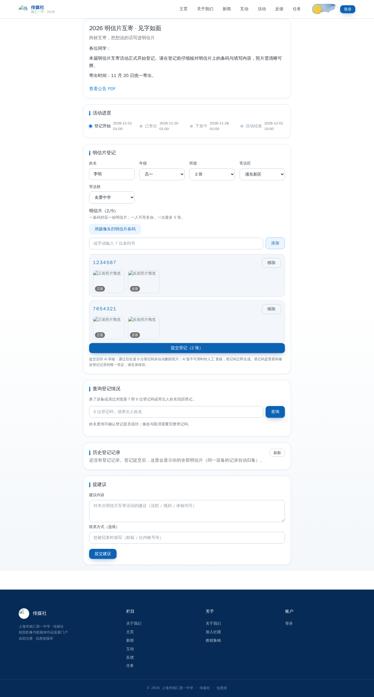
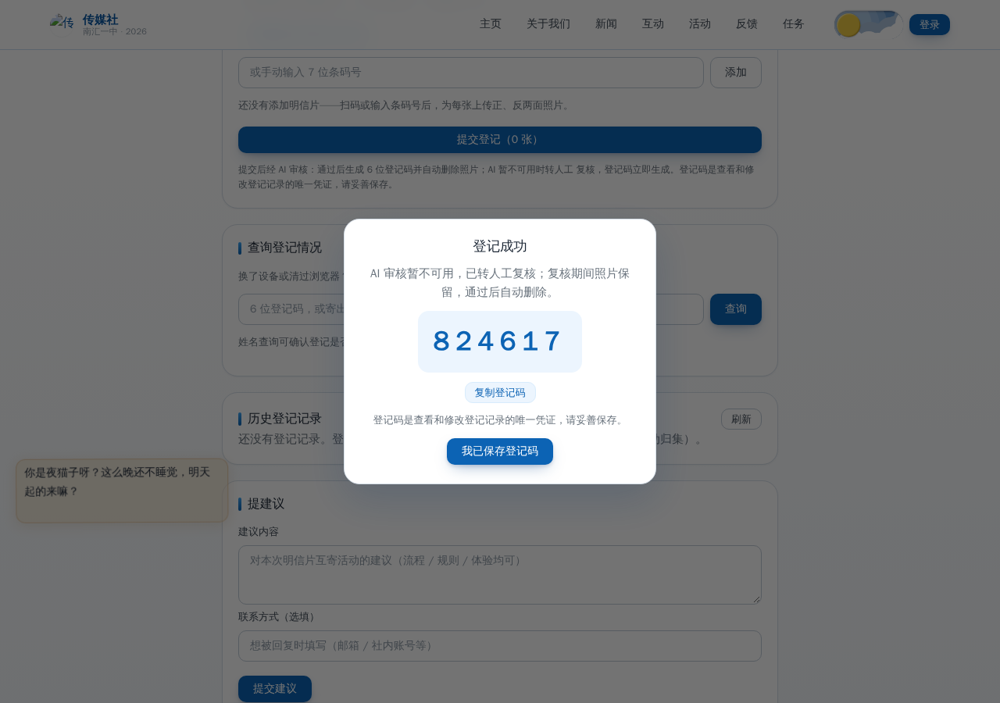
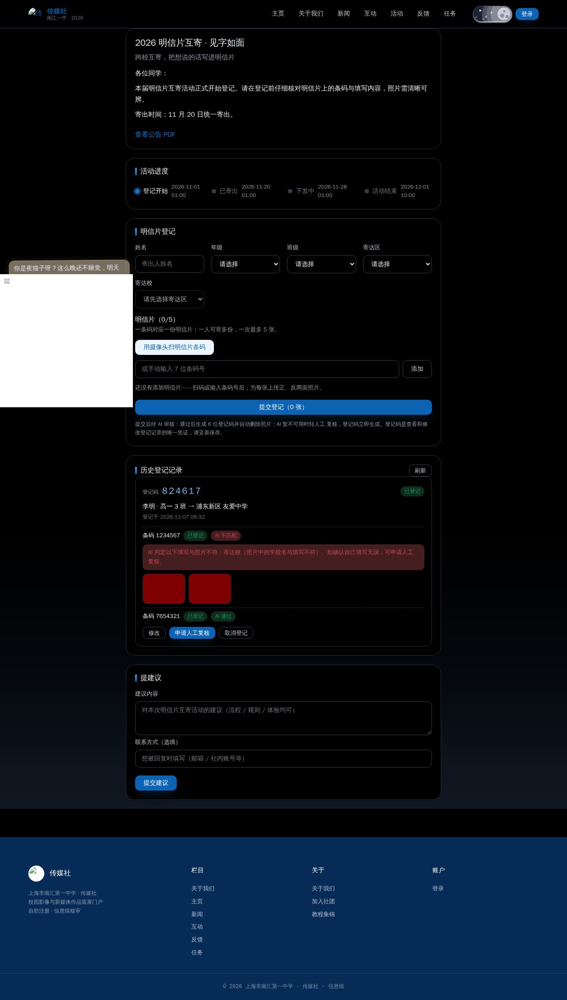
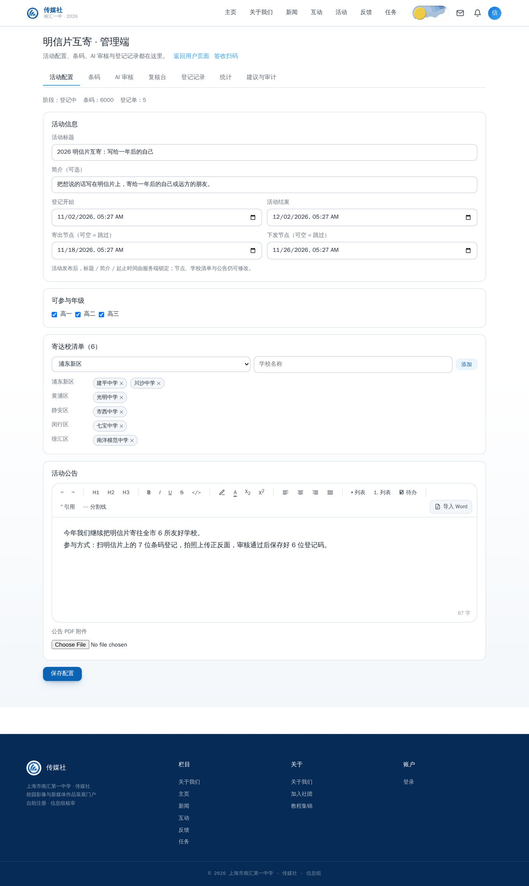
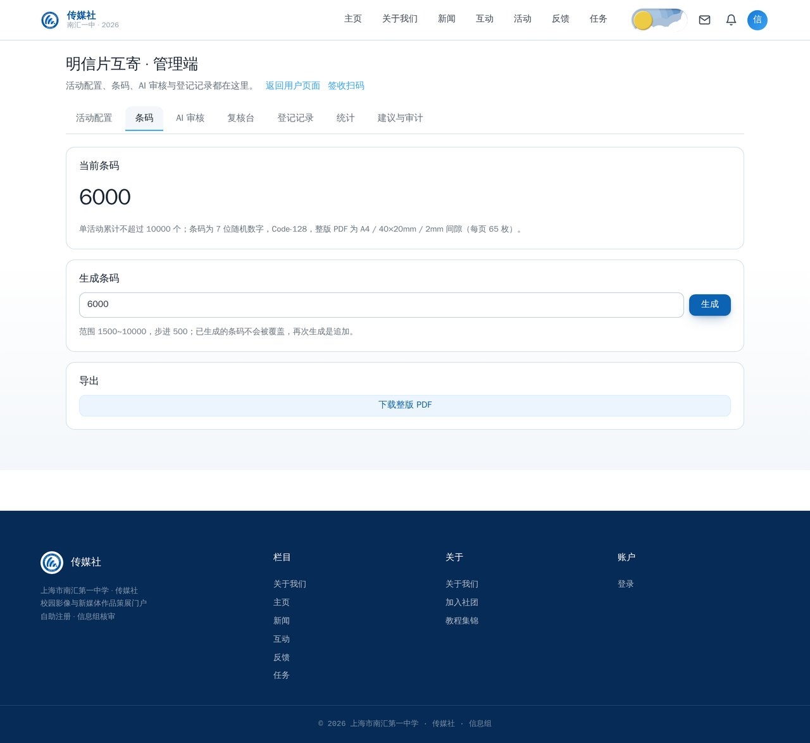
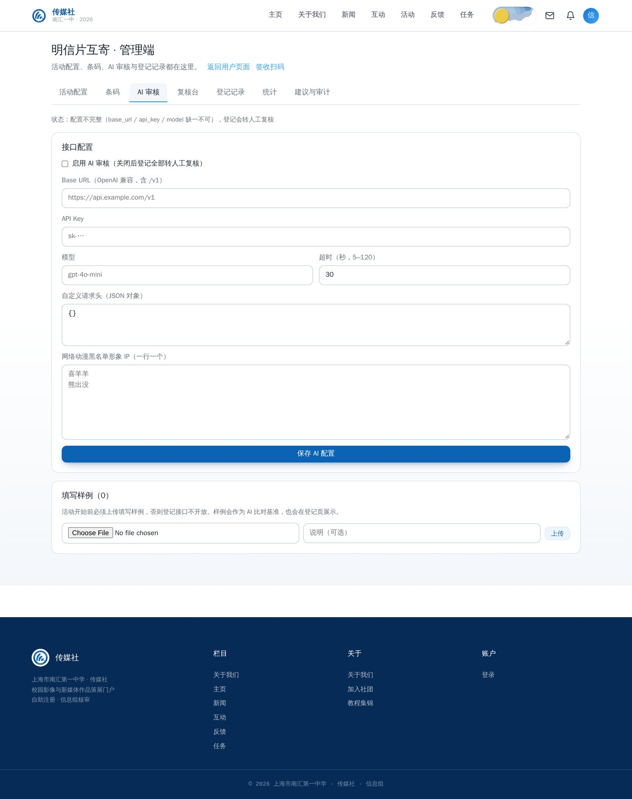
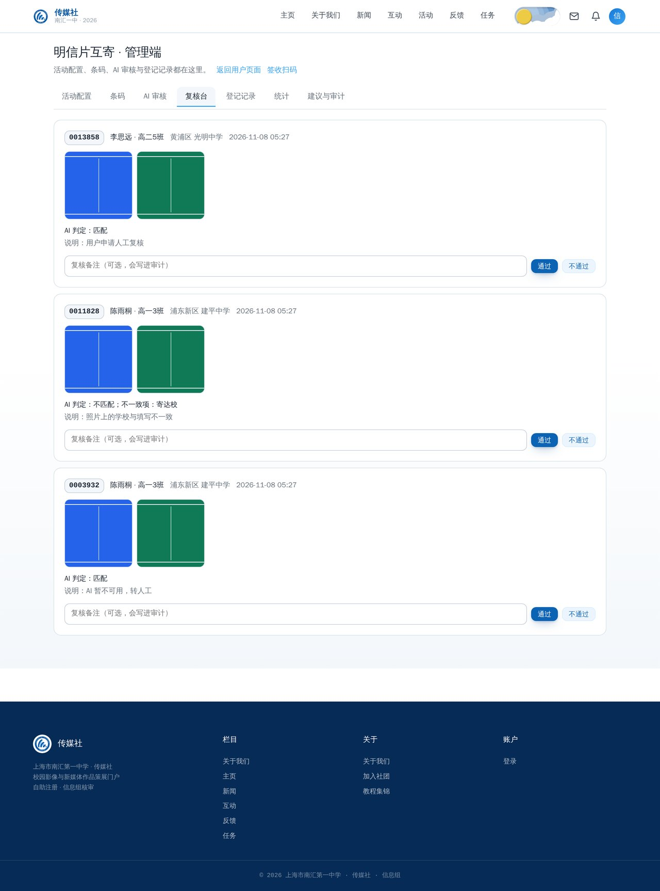
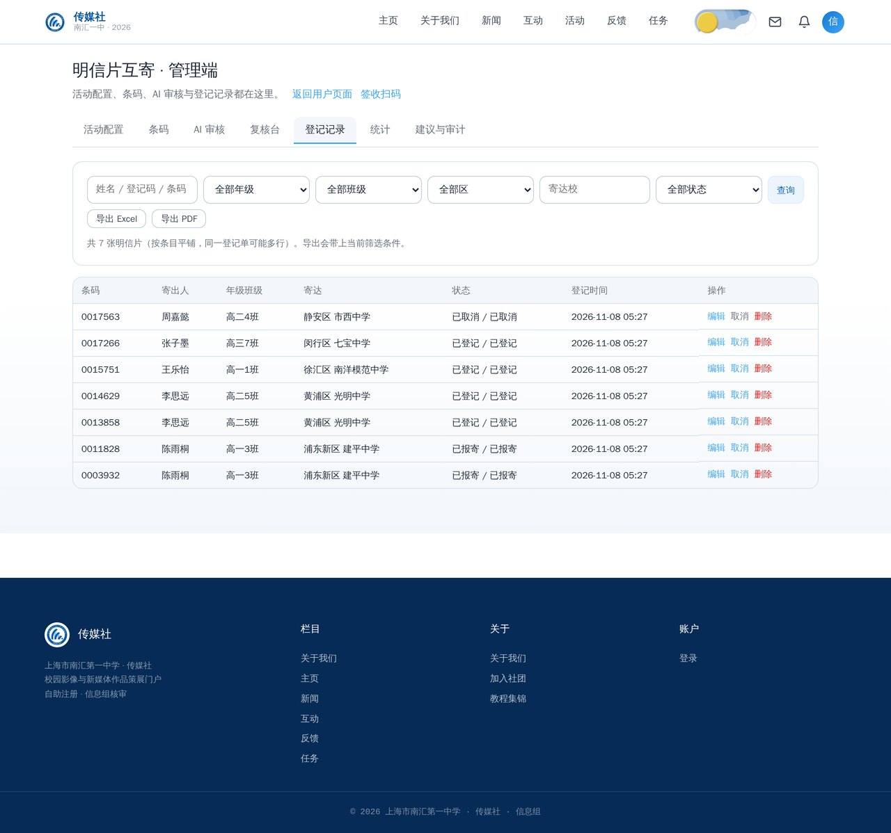
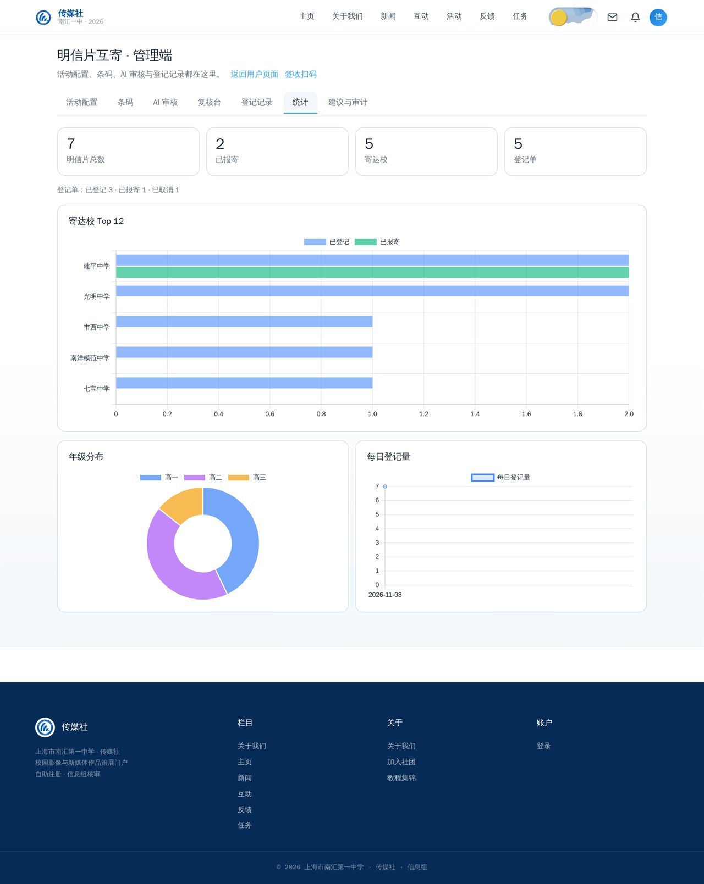
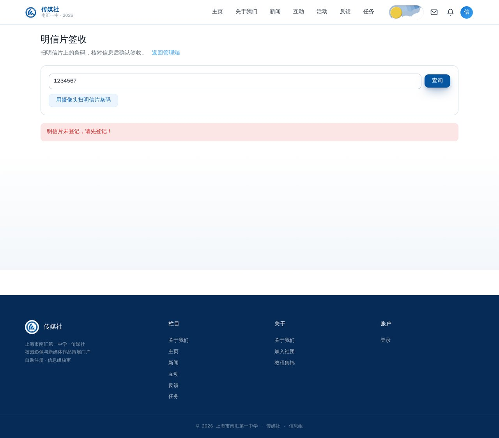

# 明信片互寄指南

明信片互寄是站内第一个「重大活动」形态：社团统一印制带 **7 位条码**的明信片，成员在活动期内登记自己手上的明信片、拍照上传正反面，系统用 AI 按管理员上传的填写样例检查内容，通过后发放 **6 位登记码**；对方学校收到后由管理员扫码签收。整条链路含多届活动、条码打印、复核台、导出与审计。

- 用户入口：`/#/postcard`（主页「重大活动」与手机版首页「重大活动」）
- 管理入口：`/#/postcard/admin`（六个分区：配置 / 条码 / AI / 记录 / 统计 / 建议与审计；复核在审核台）
- 签收入口：`/#/postcard/receive`
- 接口字段级说明：[明信片互寄 API](../api/postcard.md)；需求与实现决策：[实施方案](../plans/postcard-exchange.md)

## 一、活动阶段

阶段按时间自动推导（管理员改节点时间即改阶段，无定时任务）：

```text
未开始 ──登记开始──> 登记中 ──寄出节点──> 已寄出 ──下发节点──> 下发中 ──活动结束──> 已结束
```

- 未配置 / 草稿 / 未到 `start_at` → **未开始**，用户页只显示公告与进度，不显示登记表单；
- **仅「登记中」开放登记**；寄出 / 下发节点可留空 = 跳过该阶段；
- 到 `end_at` → **已结束**，只读，并触发照片文件全量清理（登记数据保留）；
- 管理员可随时归档当前活动、开启下一届。

## 二、成员：怎么登记

1. 打开 `/#/postcard`，阅读公告（可下载公告 PDF）。
2. 在「登记中」填写：**姓名、年级、班级、寄达区、寄达校**。寄达区是上海市固定 16 区（按固定顺序），寄达校按所选区从管理员配置的清单里过滤、按区内编号排序。
3. 逐张录入明信片上的 **7 位条码**（支持摄像头扫码 / 手工输入），**每张都要上传正反面照片**；一次最多 5 张。
4. 通过人机验证后提交。照片会先压到最长边 1280、剥离 EXIF，再送入 AI 审核。



### 登记码规则（重要）

- **同一发件人（姓名 + 年级 + 班级）在活动内共用一个 6 位登记码**；再次提交仍是独立记录（各自的寄达校与审核状态），但码相同。
- 发码时机由服务端判定：
  - AI 审核中 → 弹窗显示「审核中」，**先不发码**（前端用一次性轮询凭证查状态，2 秒轮询、40 秒封顶）；
  - AI 通过 / 已转人工复核 / 人工通过 → **亮码**；
  - AI 判不匹配 → 不发码，告知具体错项；用户可申请人工复核，转人工后立即亮码。
- 登记码是**能力凭证**：凭码可在任何设备查看、修改、取消自己的登记。请提醒成员截图保存。



### 查询、修改与取消

- **查询入口**：在用户页输入 6 位登记码 → 返回完整登记信息，可直接改 / 取消 / 申请复核；输入姓名 → 只返回**掩码**结果（`82****`），用于确认「登记是否成功 / 当前状态」，修改必须出示完整码。
- **修改**：只能改姓名 / 年级 / 班级 / 寄达区 / 寄达校；条码与照片不能改（实物已印好）。同一码有多份提交时需先选定要改的那一份。
- **取消**：可取消单份；也可整批取消该码下全部提交（不可逆，前端要求重新输入 6 位码二次确认）。
- 审核中若离开页面，可回「历史登记记录」凭设备 / 登录账号继续查看；失败照片在关闭页面时自动清理，24 小时兜底。



### 建议箱

同一页可提交活动建议（≤1000 字，可选联系方式），限流 5 次/时（IP + 设备），需过人机验证。

## 三、管理员：活动配置

进入 `/#/postcard/admin` →「配置」：

- **壳字段**：标题、简介、起止时间（`start_at` = 登记开始，`end_at` = 活动结束）；
- **节点**：寄出节点、下发节点（可空；须落在起止时间内且顺序正确）；
- **可参与年级**：高一 / 高二 / 高三的子集，空 = 全部；
- **寄达校清单**：每行含区、校名、区内编号；区必须是固定 16 区之一，编号 1–9999；
- **公告正文**：富文本（Word 导入可用），服务端会做白名单净化；活动期间随时可改；
- **公告 PDF**：可选，≤10MB、必须是真 PDF；前台以 `CSP: sandbox` 下发；
- 保存草稿后点「发布」；发布后 `start_at` 在未来 → 待开始，否则直接进行中。

> **开始后锁定**：标题 / 简介 / 起止时间在活动开始后不可改；节点、学校清单与公告仍可随时修改（进度更新是刚需）。



### 多届活动

「开启新一届」会归档当前活动并新建一份草稿（默认 `start_at=now+7 天`、`end_at=now+37 天`），复制上一届的年级与寄达校清单。旧届的登记、条码与审计数据全部保留，可继续查。**AI 配置是全局单例**：新一届继承 Base URL / 模型 / 请求头 / 超时 / 温度 / 黑名单 / 前置提示词，但 **API Key 会清空**，需管理员重新填写。

需要彻底清理某一届（连同照片 / 登记 / 条码 / 审计）时，用 Django 后台 `活动 → 明信片配置` 的只读一览 + 动作「删除该年度互寄批次（含全部数据，不可恢复）」；动作走二次确认，删前会先清私有存储里的照片、样例图与公告 PDF。日常配置仍走门户管理端，后台不提供新增 / 编辑。

## 四、管理员：条码与打印

「条码」分区：

- 数量 **1500–10000，步进 500，默认 6000**；单活动累计上限 10000；
- **增量生成**：在已有条码上追加；
- **覆盖重建**：只清「尚未被登记占用」的条码；一旦有条码已被登记，覆盖会被拒绝（避免把已发出的实物作废）；
- 导出 A4 整版 PDF：条码 40×20mm、间隙 2mm、每页 5×13 = 65 枚，6000 张约 93 页，服务端流式生成不落盘。

> 条码是随机 7 位数字（Code128），不是社员识别码；一条码只对应一张明信片，登记后即绑定。



## 五、管理员：AI 审核与样例

### 必须先配样例

**活动至少上传一条「填写样例」才开放登记**——样例是 AI 判断填写是否规范的参照。样例照片与用户照片走同一道安全管线（魔数 / 解码炸弹防护 / 重编码 / 私有存储）。

### AI 配置（全局单例）

「AI」分区配置 OpenAI 兼容服务：Base URL（含 `/v1`）、API Key、**模型 ID**、**温度（0–2，步进 0.1，默认 0；越低越确定）**、自定义请求头、超时（5–120 秒）、动漫形象黑名单（默认 38 条）、**前置提示词**（多行；每次 AI 请求并入首条 system 消息，审图 / 样例解读 / 海报识别 / 测试连接统一生效，空 = 不附加，有默认文案）。Base URL / 模型 ID / 超时 / 自定义请求头收在「**高级选项**」折叠区。**所有 AI 按钮**（测试连接 / 拉取模型 / 读样例 / 导入海报 / 模拟判定）都用当前表单填写的草稿参数，不落库——填完不必先保存就能逐个试。

- **快捷预设**：DeepSeek / OpenCode-GO / 其他。预设只覆盖各家的接入差异（Base URL、模型 ID、必需请求头与超时），**不动 API Key 与开关**；OpenCode-GO 会自动生成稳定的会话串。选「其他」清空预设、全部手填。
- **模型选择**：点「拉取模型」从服务商 `{base_url}/models` 实时取清单（限 120 次/时；不内置写死的模型清单，订阅变了也不会过期），从下拉自选；服务商没有 `/models`（404）时可继续手填模型 ID。
- **API Key 写后不可读**：页面只显示「已配置」，换 key 只能整体重填；
- 「测试连接」用**当前填写的参数**（不落库）发一次最小请求，显示延迟与回复，不回显密钥（限 60 次/时）；保存后才会对正式审核生效；
- 「让 AI 复述样例」可核对模型是否真的理解了填写规范（识别错就换样例或换模型；限 10 次/时）。

> **升级提示（2026-11）**：迁移 `0008` 会把已存配置的动漫黑名单与前置提示词**整体覆盖**为新的默认值（38 条黑名单 + 给定文案）——这是管理员口径，旧清单是早期摘录；覆盖后仍可在页面自行增删改写。

审核管线：用户照片 + 管理员样例 + 规则 + 黑名单 → 严格 JSON（是否匹配、错项、黑名单命中、评语）。最多 6 次调用机会、指数退避；全败自动转人工复核。连续 5 个用户失败会邮件告警所有绑定邮箱的管理员。



### 海报导入寄达校

配置页支持上传活动海报，由 AI 识别「参与学校 + 所在区 + 区内编号」，结果先填入表单，**管理员核对后保存才生效**（识别不落库，识别错不会污染线上清单）。限流 10 次/时。

## 六、管理员：复核台

明信片复核已并入统一审核台（入口 `/#/reviews` 的「明信片」桌，或 `/#/reviews?kind=postcard`）：

- 队列按条目（一张明信片）聚合，显示登记信息、正反面照片与 AI 判定详情；
- 状态筛选：**待人工** / **AI 不匹配** / 全部；
- 动作：**通过** → 照片立即删除、按规则亮码；**不通过** → 照片留 24 小时 TTL，用户可看到原因；
- 有新的复核申请会给持 `events.review_postcard` / `events.manage_postcard` 的管理员发站内信；同一登记码的未读通知聚合为一条，避免活动当天刷屏。



权限拆分：`events.review_postcard` 只给复核 / 签收（适合检录志愿者），`events.manage_postcard` 管配置 / 条码 / 记录 / 导出 / 统计 / AI（管理权限隐含复核）。

## 七、管理员：记录、导出与统计

- **记录**：按条目平铺（登记单信息随行），支持按姓名 / 登记码 / 条码搜索，按登记状态、条目状态、年级、班级、学校、区筛选；
- **导出**：Excel（xlsx）或 PDF，筛选条件与列表一致；公式注入防护与全站导出一致；
- **统计**：登记单 / 条目的总数与状态分布、寄达校数、按校、按年级、按日；**已取消条目不计入总数与分布**；
- **改 / 删**：按单份提交 id 操作；同一登记码有多份提交时，按码操作会被拒绝（避免误伤整批）；
- **审计**：配置变更、条码生成 / 覆盖、导出、记录改删、复核、签收、AI 配置与样例、海报导入全部留痕（操作者 / IP / 时间 / 详情）。





## 八、管理员：签收

打开 `/#/postcard/receive`（或管理端「签收」）：

1. 扫明信片上的 **7 位条码**（摄像头 / 扫码枪 / 手工输入均可）；
2. 命中后显示所属登记单信息；
3. 确认后该张置「已报寄」；登记单下全部有效条目都已报寄时，登记单自动变为「已报寄」；
4. 未命中提示「明信片未登记，请先登记！」；误签可「回退」。



## 九、照片与隐私

- 照片存**私有存储**，不进入公开 `media/`；只有复核权限或持该登记单的 6 位码才能读取；
- 通过后立即删除文件；不通过留 24 小时 TTL；活动结束全量清除；
- 登记数据（姓名 / 班级 / 寄达校 / 条码 / 状态）永久保留，除非管理员手动删除；
- 服务端安装 `postcard_photo_gc` 每小时兜底（`scripts/install.sh` 自动创建 systemd timer），处理活动结束清理、失败照片 TTL、卡死 pending 转人工。

## 十、模拟环境（演练用，2026-11-09）

想先练手、或者验收新功能，不用拿正式数据冒险：

1. 打开明信片管理端，点标题旁的**模拟活动** → 弹窗「是否进入模拟操作」→ 确认；
2. 页面标题会多一个**红底白字**的「模拟环境」；用户页 / 审核台 / 签收页右下角有同样的浮标；
3. 这里可以把整条流程走一遍：配活动 → 上传填写样例 → 生成条码 → 用户端登记 → 审核台复核 → 签收 → 看统计；
4. **数据只在当前标签页内存里**：用户页 ↔ 管理端来回切都不会丢；点「退出模拟」会先二次确认，确认后清空；关掉标签页 / 刷新同样清空，不会写进正式数据；
5. 需要 AI 的环节**会真调 AI**（登记判定 / 测试连接 / 导入海报 / 读样例），只是结果不落库、不写正式审计；
6. 登记判定规则与正式完全一致：通过 → 亮码；判不匹配 / 命中黑名单 → 不发码并列出错项，可「申请人工复核」；AI 不可用 → 转人工但立即发码。

注意几点：

- 模拟里的 AI 判定会**消耗真实额度**（每张明信片一次调用），演练时别反复刷；
- 登记用的「填写样例」门禁保留真实语义：没上传样例不开放登记；
- 没有 Turnstile / 限流 / 站内信（这些是防御设施，不影响练手）；
- 导出的条码 PDF / 表格是浏览器现造的示意件，文件名带「仅限模拟环境使用」，**不能拿去打印发放**。

## 十一、常见问题

**Q：登记时提示「活动填写样例尚未配置」？**
管理员需先在「AI → 样例」上传至少一条填写样例，登记才会开放。

**Q：审核一直显示「审核中」？**
AI 调用超时 / 失败会自动转人工复核，转人工后立即亮码；也可让成员在页面申请人工复核。后台可用「测试连接」排查 AI 配置。

**Q：同一学生登记两次，为什么只有一个登记码？**
同一「姓名 + 年级 + 班级」在活动内共用登记码，这是 2026-11-08 定的规则；两次提交仍是独立记录，可分别修改 / 取消。

**Q：条码能不能重新生成？**
可以「覆盖重建」，但只清未被占用的条码；已有登记占用时会被拒绝，此时请增量生成。

**Q：手机系统相机扫条码为什么只显示数字？**
7 位条码是 Code128 一维码，微信 / 系统相机只解析出数字、不跳转；登记与签收都要在站内页面扫码或手工输入。
